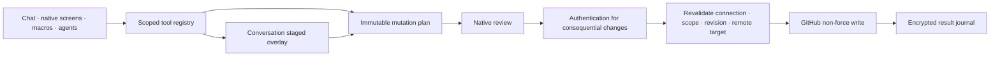

# Architecture

## Modules

`RepoManagerCore` owns provider protocols, domain records, transport, GitHub/OAuth, workspaces, tool schemas and execution, approval enforcement, secure records, history merge/sync, backups, encrypted assets/inbox and external-agent contracts. Its documentation executable exports the actual catalog and is not included in the app.

`RepoManagerUI` owns adapted presentation: tokens, workbench/sidebar, mounted workspaces, composer, transcript components, reasoning/activity and the repository-case brand. It imports no model runtime.

The app installs production adapters: Keychain, Apple Foundation Models/PCC, native speech, device authentication, app lifecycle, BGTasks, screens and privacy cover. Shared types are `Sendable`; services serialize shared state through actors. `AppModel` is a focused `@MainActor @Observable` presentation owner.

## Run and state ownership

Each conversation owns provider/model, persona, repository connection/ID/branch, messages, composer/attachments, reading position, explicit memory/instructions, local editor drafts and staged workspace/checkpoints. Switching navigation leaves visited hosts mounted. Hidden hosts suppress decorative motion, accessibility and interaction.

A run captures its conversation, provider profile, endpoint, model and repository scope before asynchronous work. A run lease and draft revision identify callbacks. Stop, selection/provider changes, account disconnect and background cleanup cancel work and invalidate pending reviews. Cancellation barriers complete before a replacement run or native mutation review binds the same conversation. Late callbacks cannot append to a newly selected conversation.

The run coordinator performs bounded context compaction without deleting the visible transcript, obtains permitted tools, streams normalized events, executes app tools, and returns tool results to the same provider. Plan mode allows reads/proposals; Act additionally permits local staging. Native cloud structured calls are preferred. An explicit text-tool bridge executes only complete top-level tool structures, excluding quoted examples and reasoning.

Provider continuation state is bound to exact profile ID, model ID and endpoint. Claude signatures, Gemini thought signatures, OpenRouter reasoning details and Responses encrypted continuation are replayed only to that destination. The app does not invent hidden reasoning or run a separate model classifier for effort choice.

## Approvals and publication

Reviews bind action/arguments, before state, expected branch head, complete draft, connection and target identity in an immutable digest with expiry. The coordinator rejects reuse, altered arguments, switched scope, draft edits, expiry, cancellation and changed remote state. Repository deletion/transfer require the full name. Additional native confirmation and owner authentication cover administration, secrets, visibility/protection/permission changes and deployment approvals. Voice and APIs cannot approve.

Publication creates blobs/tree/commit and performs a non-force ref update. File modes `100644` and `100755` are preserved. Symlink/submodule metadata is readable but not text-editable. A merge commit preserves both parents. Branch advancement retains the overlay for three-way restaging. Checkpoints restore local drafts without rewriting remote history. Reverts create forward commits.

Account-scoped repository creation uses a distinct immutable plan with repository ID zero until GitHub supplies an ID; it never manufactures an existing repository binding. Creation verifies the signed-in account and target absence before and after review.

An interrupted/lost write is uncertain, remains in the journal and blocks blind retry. Reconciliation inspects the reviewed target by stable repository ID and original reviewed arguments. HTTP 202 means accepted, not completed; asynchronous fork/transfer/dispatch effects require inspection of the returned GitHub target/activity.

## Storage and networking

`SecureStore` uses opaque filenames, fresh AES-256-GCM nonces, authenticated version/object IDs and atomic protected writes. Credentials and vault keys use separate nonsynchronizing, device-only, unlocked Keychain items. No preferences, environment or plaintext fallback exists. Search is an in-memory lexical index rebuilt from encrypted documents. Large assets use encrypted bounded chunks. Share uses ephemeral X25519/HKDF and AES-GCM with a main-app-only private Keychain key and a shared public key.

Optional CloudKit history is encrypted with a separate explicitly enabled synchronizable Keychain key. Drafts, attachments, repository scopes, editor drafts, credentials, caches, approvals and agent grants are not synced. Tombstones prevent resurrection; divergent message edits receive deterministic conflict-copy IDs so interrupted imports can repeat safely. Local drafts/bindings survive merged history.

Outgoing content connections validate HTTPS/URL/DNS policy, connect to one resolved public IP, and validate TLS against the original hostname with system trust. They reject redirects and automatic retries; no URLSession cache, cookie jar, proxy redirection or plaintext temporary upload file is used. A strict bounded HTTP/1.1 framer handles fixed/chunked/connection-close bodies. Provider SSE parsing handles split UTF-8 and bounded frames.

The opt-in NWListener uses a Keychain/Secure-Enclave-backed identity where supported, a host/IP-valid certificate, per-client Keychain tokens and encrypted grants. Versioned ownership checks apply to sessions/runs/tools/events. Headers, bodies, stream buffers, client count, connections and authentication attempts are bounded. No existing chat history endpoint is provided.

## Lifecycle

Foreground restore is coalesced and cancellation guarded. Inactive UI is covered by a scene-owned native window, including presented sheets. Background/lock cancels runs, approvals, voice and listener, releases decrypted workspace/knowledge/presentation state and preserves ciphertext. The foreground can restore without network access.

Separately opted-in BGAppRefresh/BGProcessing refresh at most three explicitly selected current repository scopes and optional encrypted history while protected data is available. They never start AI runs, execute mutation tools, approve reviews or keep an API listener alive. Foreground, lock and expiration cancel workers. iOS determines timing; the app does not promise continuous background execution.

## Principal contracts

| Interface | Responsibility |
| --- | --- |
| `ProviderClient.stream(RunRequest)` | Normalized text/reasoning/tool/usage/error stream |
| `ToolRegistry.execute(ToolCall, context:)` | Validated, scoped built-in execution |
| `GitHubWorkspace.prepare` | Complete immutable draft review |
| `ApprovalCoordinator.confirm` | Native review, owner proof, revalidation and receipt |
| `SecureStore.load/save` | Authenticated encrypted records; no recovery overwrite |
| `VoiceService.events` | Speech states and transcripts, never approval authority |
| `AgentAPI.handle` | Bounded typed compatibility and app-agent contracts |

See the full specification and the dated QA/security evidence for acceptance and platform limitations.

The leading drawer owns native touch and accessibility focus. A retained workspace host is detached while obscured, with only a noninteractive in-memory backdrop. Closing the drawer reattaches the same controller/state. Hidden workspaces discard the backdrop; background/lock removes decrypted presentation, including these transient views.
